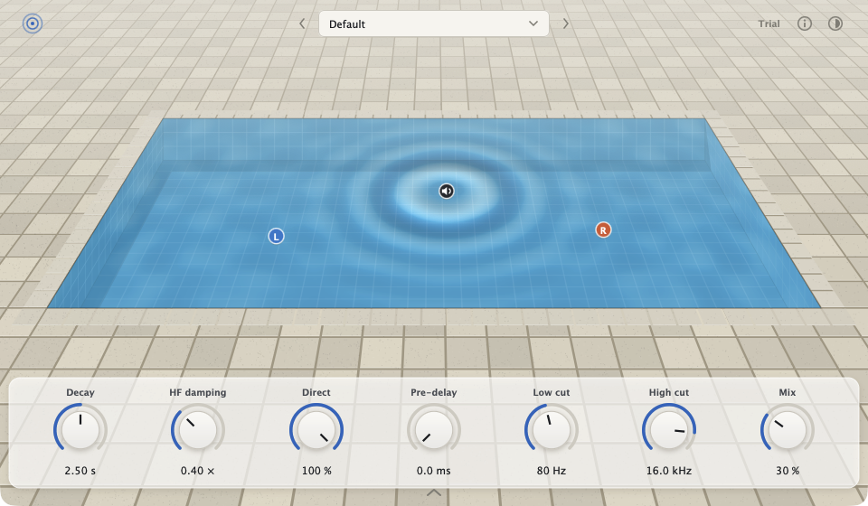

# Surface

Surface is a plate reverb that models the plate itself. A tensioned rectangular plate is
computed as its individual resonances, about 26,000 of them for the default plate, and the
signal is applied at a driver and collected at two pickups, as in a studio plate reverb. The
reverberation is therefore that of the plate described by the controls, and it changes in
the manner of a real plate when the plate, the driver or the pickups are changed.

The plate is shown as a pool of water, on which each new sound appears as a ripple
spreading from the driver. The driver and the pickups are moved by dragging them.

This repository is where Surface releases are published. **[Download the latest
release](../../releases/latest).**

## Features

- **Decay** and **HF damping** set the reverberation time and how much sooner the high
  frequencies decay.
- The driver and both pickups may be placed anywhere on the plate, and their positions may
  be automated.
- **Direct** removes the wave that travels straight from the driver to the pickups, leaving
  the reflections from the plate's edges.
- The plate's material, size, proportions, thickness, tension and highest frequency may be
  set. The materials are steel, brass, aluminium and gold foil.
- **Pre-delay**, **Low cut**, **High cut** and **Mix**.
- Factory presets, and user presets saved as files.
- Light and dark themes.
- No latency is added at sample rates up to 48 kHz.

## Requirements

- macOS 13 or later, on Apple silicon or Intel.
- A host that loads Audio Units, VST3 or AAX plug-ins: Logic Pro, Pro Tools, Ableton Live,
  Cubase, REAPER, Studio One and others.

## Installation

The installer, a `.pkg` file, installs Surface for all users:

- the Audio Unit in `/Library/Audio/Plug-Ins/Components`;
- the VST3 in `/Library/Audio/Plug-Ins/VST3`;
- the AAX in `/Library/Application Support/Avid/Audio/Plug-Ins`.

Any format may be left out by choosing **Customize** in the installer. The installer is
signed with a Developer ID and notarised by Apple.

## Trial and licence

Without a licence, Surface runs in full, but a short tone sounds every 30 seconds of audio.
To activate it, enter the e-mail address to which the licence was issued and the licence
token in the panel that opens with the plug-in, or later from the information button in the
header. Activation takes place offline and covers every Surface instance on that user
account.

## Removal

Delete `Surface.component` from `/Library/Audio/Plug-Ins/Components`, `Surface.vst3` from
`/Library/Audio/Plug-Ins/VST3` and `Surface.aaxplugin` from
`/Library/Application Support/Avid/Audio/Plug-Ins`.

---

© Mark Hammond. All rights reserved.
